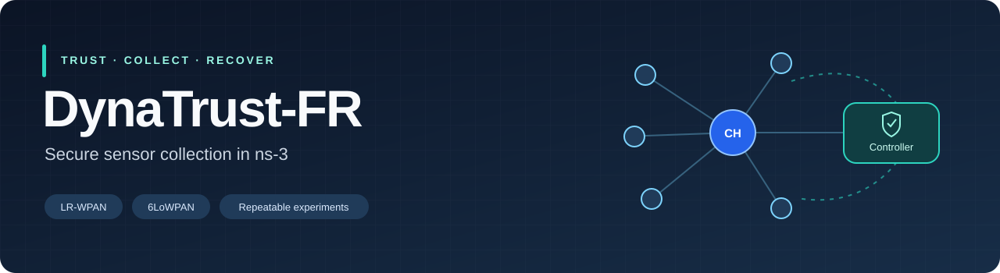
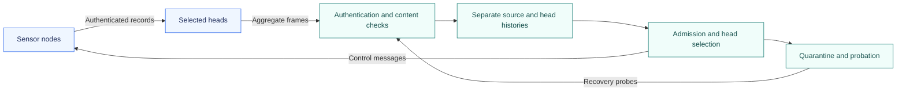

<p align="center"></p>

<p align="center">
<a href="https://github.com/Devchandrasen/dynatrust-fr-implementation/actions/workflows/validation.yml"></a>


</p>

<p align="center"><a href="#quick-start">Quick start</a> · <a href="docs/architecture.md">Architecture</a> · <a href="docs/experiments.md">Experiments</a> · <a href="docs/getting-started.md">Setup guide</a></p>

DynaTrust-FR is a toolkit for secure sensor-collection experiments in ns-3. Mobile nodes send authenticated readings through selected cluster heads over LR-WPAN and 6LoWPAN. The controller handles trust, report admission, head selection and recovery.

The repository includes simulator implementations, unit tests, recorded runs and tools to check or replay an experiment.

## What it provides

| Component | Purpose |
| --- | --- |
| Authenticated messages | Source tags, sequence checks and variable-length aggregate frames |
| Robust recommendations | Clipping, trimming and separate source/head histories |
| Head selection | Energy, position, reliability and rotation controls |
| Admission and recovery | Content checks, quarantine, probation and authenticated probes |
| Optional detection modes | Commissioned, sequential and rolling checks; independent references and calibration fixtures |
| Repeatable runs | Recorded arguments, round-level CSVs, metrics and SHA-256 checks |

## Quick start

Check the included data with Python:

```bash
git clone https://github.com/Devchandrasen/dynatrust-fr-implementation.git
cd dynatrust-fr-implementation
python3 scripts/verify_results.py
```

Run the C++ component checks:

```bash
python3 scripts/run_unit_tests.py
```

With a built ns-3.47 runtime, replay one recorded calibration case:

```bash
python3 scripts/run_study.py \
  --study calibration --phase primary \
  --scenario c50 --variant certified-veto --limit 1 \
  --ns3-root /absolute/path/to/ns-3.47 \
  --output runs/calibration-check
```

This builds the selected source snapshot, runs the recorded configuration and compares every CSV field with the included result. Choose a new output directory for each replay. See the [setup guide](docs/getting-started.md) for runtime installation.

## Collection flow



## Experiment collection

The collection contains **5,320 missions**, **1,855,000 rounds** and **7,200 local fusion trials**. Development runs are separate from these evaluation cohorts.

| Collection | Missions | Rounds | Coverage |
| --- | ---: | ---: | --- |
| [Core](experiments/core) | 1,510 | 467,000 | Policies, mobility, scale, role history and impairment |
| [Commissioned](experiments/commissioned) | 600 | 222,000 | Offset calibration and delayed-value checks |
| [Sequential](experiments/sequential) | 810 | 285,000 | Intermittent attacks, common events and coverage |
| [Rolling](experiments/rolling) | 870 | 338,000 | Recovery windows, audits, loss and depletion |
| [References](experiments/references) | 760 | 284,000 | Reference counts, failures and cost |
| [Calibration](experiments/calibration) | 770 | 259,000 | Calibration validity, direct veto and keep-all controls |

Each collection has its own source snapshot and manifest. Use the [experiment guide](docs/experiments.md) to select cases and export their metrics.

## Verification

- Unit checks cover fusion, role history, temporal and sequential state, recovery, reference quorums and calibration records.
- Data checks validate source hashes, decompressed CSV hashes, round counts, counter relationships and stored aggregate metrics.
- Replays use the recorded arguments and compare the resulting rows with the selected fixture.
- GitHub Actions runs unit and data checks on each push and pull request.

Simulator keys are deterministic for repeatable runs. Device deployments require independently provisioned secrets. Detection modes depend on their declared calibration, reference and measurement assumptions; the collection includes failure controls for these conditions.

## Project layout

```text
experiments/
  catalog.json             Collection index and runtime version
  core/                    Core implementation and recorded runs
  commissioned/            Commissioned detection
  sequential/              Sequential detection and common events
  rolling/                 Rolling recovery and audits
  references/              Independent reference modes
  calibration/             Calibration fixtures and direct veto
scripts/
  run_study.py             Build and replay recorded cases
  run_unit_tests.py         Compile and run C++ checks
  verify_results.py        Validate the included data
  summarize_results.py     Export grouped metrics
docs/                      Setup, architecture and experiment guides
ns3/scratch/               Earlier simulation examples
python/dynatrust_fr/        Lightweight algorithm sandbox
```

The complete LR-WPAN/6LoWPAN implementations are under `experiments/`. The earlier WiFi examples and Python sandbox remain available for exploring individual components.

See [CONTRIBUTING.md](CONTRIBUTING.md) for change and test guidelines.
