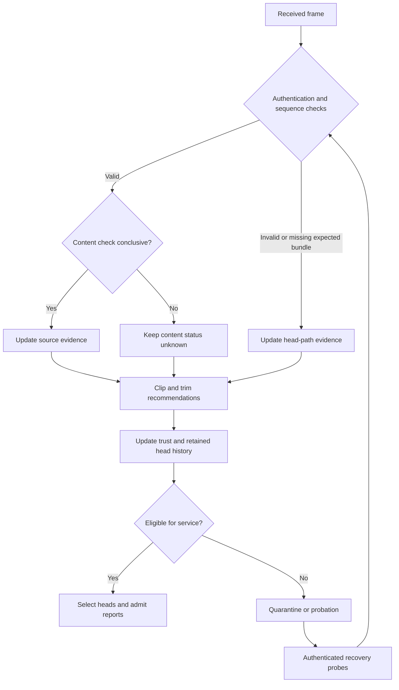

# Architecture

| Component | Responsibilities |
| --- | --- |
| Sensor application | Generate readings, authenticate records and respond to controls |
| Cluster head | Receive member frames, form bundles and forward authenticated records |
| Controller | Check frames, update evidence, select heads and decide admission |
| Recovery state | Track quarantine, probation and received successful probes |
| Reference input | Supply independently authenticated field measurements |
| Calibration input | Load bounded, identity-bound correction records |

The transport uses UDP/IPv6 over 6LoWPAN and IEEE 802.15.4 LR-WPAN. Frame traces include fragmentation, retries and radio-state energy.

Source reporting and head forwarding have separate histories. A successful source report does not clear a previous head-path failure.

## Frame accounting

| Application field | Bytes |
| --- | ---: |
| Fixed frame header | 19 |
| Source record | 18 |
| Aggregate with `m` source records | `27 + 18m` |
| Source, probe or audit frame | 37 |

Network and MAC overhead are counted separately. Large bundles use 6LoWPAN fragmentation.

## Mode boundaries

Peer-derived references need enough authenticated observations and a coherent reference group. Commissioned modes require a suitable initialization interval. Independent reference and calibration modes add separate measurement assumptions. Recorded loss, invalid-calibration and faulty-reference inputs exercise these boundaries.

Recovery depends on the configured trust threshold, minimum hold and received successful probes. Finishing the hold alone does not restore eligibility.
